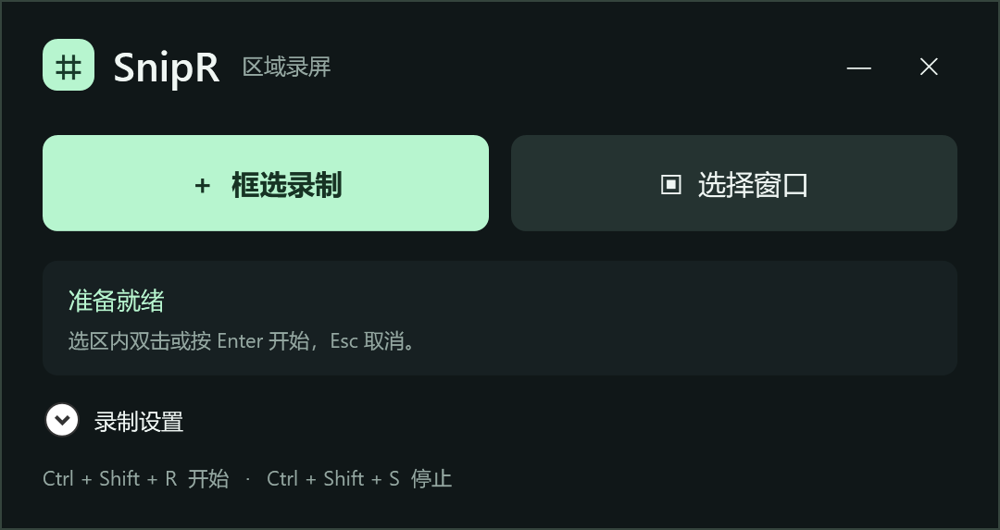
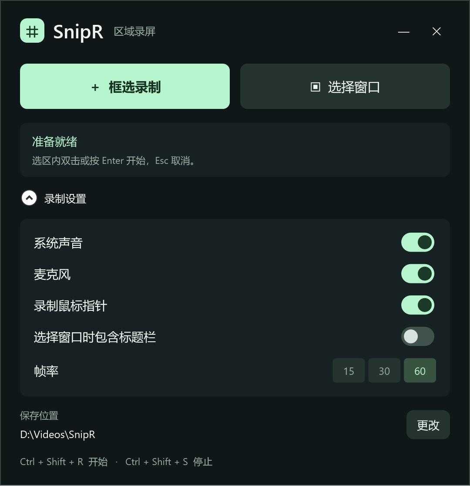

<p align="center">
  
</p>

<h1 align="center">SnipR</h1>

<p align="center">框选屏幕，录下需要的部分。</p>

<p align="center">
  <a href="https://github.com/saderickhuang/SnipR.Net/releases"></a>
  <a href="#直接运行"></a>
  <a href="src/SnipR/SnipR.csproj"></a>
  <a href="src/SnipR/MainWindow.xaml"></a>
  <a href="LICENSE"></a>
</p>

<p align="center">
  <a href="https://github.com/saderickhuang/SnipR.Net/releases">下载预览版</a> ·
  <a href="#直接运行">使用说明</a> ·
  <a href="https://github.com/saderickhuang/SnipR.Net/issues">反馈问题</a>
</p>

SnipR 是基于 **C# / .NET 10 / WPF** 的开源 Windows 区域录屏工具，采用 MIT 许可证。支持自由框选、窗口内容选择、系统声音与麦克风同时录制，导出 H.264 / AAC MP4。当前为 **v0.1.1 预览版**。

## 界面预览

主界面保留录制入口与状态，录制设置默认折叠。

<p align="center">
  
</p>

<details>
<summary>展开查看声音、帧率与保存位置设置</summary>

<p align="center">
  
</p>

</details>

录制时通过悬浮控制条查看时长、停止并保存。

<p align="center">
  
</p>

<sub>以上图片由实际 WPF 控件渲染；保存路径与计时为演示值。</sub>

## 直接运行

从 [Releases](https://github.com/saderickhuang/SnipR.Net/releases/tag/v0.1.1) 下载 `SnipR-0.1.1-win-x64.zip`，解压后直接双击 **SnipR.exe**。不需要运行脚本、安装 .NET 或使用管理员权限。

首次点击录制时，软件自动从 Gyan 下载 FFmpeg，显示进度并校验 SHA256，准备好后继续框选。下载可取消，失败可重试。**首次准备需要联网**，之后可离线录制，更新或移动 SnipR 也无需重复下载。

组件及其许可证保存在 `%LOCALAPPDATA%/SnipR/components/ffmpeg`。公开 ZIP 包含 .NET 运行时，不包含 FFmpeg。离线部署时，也可自行将支持 `gdigrab`、`libx264` 和 AAC 的 `ffmpeg.exe` 放到 `SnipR.exe` 同级的 `tools` 文件夹。移动软件时请移动整个解压目录。

支持 Windows 10 22H2 / Windows 11 x64，当前在 Windows 11、150% 显示缩放下实测。

1. 主界面只保留录制入口与状态。“录制设置”默认折叠，需要时展开，调整声音、帧率、鼠标、窗口标题栏和保存位置。系统声音与麦克风可同时开启，也可分别关闭。
2. 点击“框选录制”自由拖动，或点击“选择窗口”自动识别鼠标下的窗口。**Ctrl + Shift + R** 使用上次选择的模式。
3. 选区内双击或按 **Enter** 确认，**Esc / 右键**取消。单击不会清空已有选区，真正拖动才重新框选。窗口模式下悬停预览、单击锁定，**Tab** 重新选择窗口，也可拖动改为自由选区。
4. 3 秒倒计时后开始录像。选区边框从绿色变为红色，并在录制期间持续显示；边框不拦截鼠标操作。悬浮条显示计时，可拖动位置。
5. 点击“停止”或按 **Ctrl + Shift + S**，合并声音并保存 MP4。
6. 点击“查看视频”在资源管理器中定位文件。

默认保存到 Windows“视频”文件夹下的 `SnipR` 目录，可在主界面更改。支持 15 / 30 / 60 FPS，鼠标指针可独立开关。

设置在修改、开始录制和关闭应用时保存，下次启动自动恢复。记住声音开关、帧率、鼠标开关、标题栏选项、保存位置与上次选择模式；设置面板每次启动仍默认折叠。

“选择窗口”默认使用客户区，可在设置中包含标题栏。使用自绘标题栏的应用，其标题栏可能属于客户区。确认后录制的是固定屏幕范围，不会随窗口移动，也不支持录制被遮挡或最小化窗口的后台画面。

## 开发与构建

要求 Windows 与 .NET 10 SDK，无需 Visual Studio。

```powershell
dotnet build SnipR.slnx -c Release
dotnet run --project src/SnipR/SnipR.csproj
```

运行源码构建也支持自动准备 FFmpeg。开发者需要本地打包或运行录像验证脚本时，可选执行 `powershell -NoProfile -ExecutionPolicy Bypass -File scripts/setup-ffmpeg.ps1`，下载 FFmpeg / ffprobe 到 `tools/ffmpeg`。NuGet 依赖固定为 NAudio 2.2.1。

生成包含运行时的发布目录：

```powershell
powershell -NoProfile -ExecutionPolicy Bypass -File scripts/publish.ps1
```

上面的命令生成本地自用包（包含已下载的 FFmpeg）。生成供 GitHub 发布的 ZIP（不含 FFmpeg）请使用：

```powershell
powershell -NoProfile -ExecutionPolicy Bypass -File scripts/package-release.ps1
```

## 实现结构

| 文件 | 职责 |
| --- | --- |
| `App.xaml` | WPF 样式、资源和应用生命周期 |
| `MainWindow.xaml` / `.xaml.cs` | 主界面、设置、录制流程与全局快捷键 |
| `SelectionWindow.cs` | 透明框选层、物理像素坐标与选区绘制 |
| `SelectionGesture.cs` | 点击、拖动与双击确认状态，避免第一次点击清空选区 |
| `WindowPicker.cs` | 按层叠顺序识别窗口，过滤浮层，计算客户区或完整窗口范围 |
| `RecordingBar.xaml` / `.xaml.cs` | 倒计时、录制计时、停止与保存状态 |
| `RecordingBorderWindow.cs` | 录制范围边框、鼠标穿透、焦点保持与捕获排除 |
| `RecordingSession.cs` | 编码进程、录制生命周期、音视频合并与恢复文件 |
| `EncoderJob.cs` | Windows Job Object，应用退出时终止所属编码进程 |
| `EncoderInstaller.cs` / `EncoderSetupWindow.xaml` | 首次录制时自动下载、校验、安装组件，支持取消与重试 |
| `AudioTrack.cs` | WASAPI 系统回环 / 麦克风采集、补齐静音与设备异常检测 |
| `Settings.cs` | `%LOCALAPPDATA%/SnipR/settings.json` 设置持久化 |
| `Native.cs` | 快捷键、窗口位置、捕获排除、虚拟桌面边界 |
| `Diagnostics.cs` | 选区边界检查、动态 WPF 测试画面和真实录制验证 |

界面与录制服务分开，首版由窗口代码协调流程，尚未引入完整 MVVM 框架。

## 录制与恢复

- 框选使用物理像素，编码前将宽高向下取偶数，最多减少 1 像素；最小选区 16 × 16。
- 视频先写入分片 MP4，声音分别写入 WAV。停止后混合成一个 AAC 音轨，视频不二次编码。
- 系统无声音时保持回环采集时钟运行；两路声音按共同时间线对齐，短时空缺补静音。
- 悬浮条请求 Windows 从屏幕捕获中排除自身，并尽量放在选区外；具体效果取决于系统捕获支持。
- 录制边框为 3 个物理像素，优先显示在选区外；到达桌面边缘时向内显示，并请求 Windows 从捕获中排除。停止、取消或启动失败时会自动移除边框。
- 保存完成后才清理本次临时文件。失败时保留在保存目录的 `.sessions/<本次录制名称>/`，错误框会显示路径。
- `.sessions` 中的 `video.mp4`、`system.wav`、`microphone.wav` 可供人工恢复。没有自动恢复向导。
- 默认通过扬声器播放的声音也可能被麦克风再次收到；需要旁白时推荐使用耳机。

## 验证

```powershell
# 无需网络或音频设备的组件准备测试
dotnet run --project tests/SnipR.SetupChecks -c Release
# 以下实录检查需先运行 scripts/setup-ffmpeg.ps1 准备开发用 FFmpeg / ffprobe
scripts/verify.ps1
# 增加系统声音和麦克风测试；将实际打开默认音频设备并播放短测试音
scripts/verify.ps1 -WithAudio
# 验证录制边框的可见性、物理位置、穿透样式与捕获排除
scripts/verify.ps1 -WithBorder
scripts/verify.ps1 -WithBorder -AtScreenEdge
```

测试会短暂显示动态测试窗口，输出到 `artifacts/verification-*`，检查选区边界、视频尺寸、帧率、编码、有效时长和可解码性。带声音模式检查 AAC 音轨及短测试音。麦克风设备初始化与混音链路已实测，实际人声质量需要在使用环境中试听。

测试窗口应可见；隐藏启动会导致录到窗口后方的桌面。请勿在测试过程中遮挡或移动测试画面。

## 首版范围

当前实现自由框选、窗口自动框选与音频合并，尚不包含暂停续录、区域边缘拖拽调整、托盘常驻、设备选择列表、视频剪辑、GIF 导出和硬件编码。跨显示器负坐标已做计算检查，但多显示器混合缩放仍需实机验证。4K / 60 FPS 性能、长时间录制与音画漂移尚未做压力测试；受保护的视频或安全桌面可能无法捕获。

许可证见 [LICENSE](LICENSE)，第三方组件见 [THIRD-PARTY-NOTICES.md](THIRD-PARTY-NOTICES.md)，参与开发见 [CONTRIBUTING.md](CONTRIBUTING.md)，版本变化见 [CHANGELOG.md](CHANGELOG.md)。
